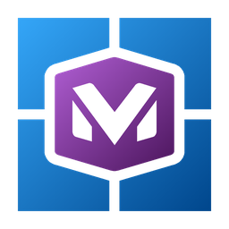

<p align="center">
  
</p>

<h1 align="center">Mirador</h1>

A Windows app for running [Monado](https://monado.freedesktop.org/), the open-source OpenXR runtime. Mirador installs
Monado, starts and stops it, switches the active OpenXR runtime, starts Monado when a game needs it, and keeps
headset vendor software out of the way while it runs. Its first supported headset is the Pimax Dream Air.

Work in progress: nothing is released yet.

## Building

You need Windows 10 version 2004 or newer, the [.NET 10 SDK](https://dotnet.microsoft.com/download/dotnet/10.0) and the
Windows 11 SDK (10.0.26100). The app is WinUI 3, unpackaged and self-contained, for x64 only.

```powershell
tools\build.ps1          # Release build of Mirador.slnx
tools\build.ps1 -Test    # the same, then all tests
dotnet run --project src\Mirador.App -p:Platform=x64
```

The stand-in (`standin\`, C) needs Visual Studio's C++ x64 tools; `tools\build.ps1` builds it first (with a warning,
not a failure, when they're missing) into `artifacts\standin\monado-service.exe`, and `standin\build.ps1` builds it
alone.

The direct-mode Vulkan layer (`layer\`, C++) needs the same tools, CMake and Ninja (Visual Studio's) and vcpkg (its
`vcpkg.json`); `tools\build.ps1` builds it into `artifacts\layer-build` after the stand-in and, with `-Test`, runs its
Catch2 tests (skipped with a warning when the C++ tools are missing, except on CI). `tools\build-cmake.ps1 -Source layer
-BuildDir artifacts\layer-build -Configure -Build -Test` builds it alone.

OpenComposite, which runs OpenVR games on Monado: `tools\get-opencomposite.ps1` downloads the 64-bit build from the
release of Mirador's fork (github.com/fzeruhn/OpenComposite), checks its pinned SHA-256 and unpacks it to
`artifacts\opencomposite`. The default pin, v2026.11.06, has no `OpenComposite-windows.zip` asset of its own: take that
file out of the release's `OpenComposite.zip` and give it as `-Zip <file>`.

The installer: `tools\build-bundle.ps1` puts the install layout in `artifacts\bundle`, then
`tools\build-installer.ps1` (Inno Setup 6: `winget install JRSoftware.InnoSetup`) makes
`artifacts\Mirador-<version>-setup.exe` from it. The bundle always has the layer, which it builds from `layer\`; without
arguments it has no Monado and no OpenComposite, as CI builds it; `-Monado <build> -OpenComposite artifacts\opencomposite`
add them.

CI (`.github/workflows/`):
- `build.yml` builds and tests every push and pull request on a Windows runner, leaving out tests marked
  `Category=Hardware` (`tools\build.ps1 -Test -SkipHardware`).
- `release.yml` builds the installer on every push (an artifact of the run); only a `v*` tag makes a draft release with
  it, after checking the tag against `<Version>`.
- `monado-weekly.yml` builds the bundled Monado: upstream Monado's `main` with `tools\build-monado.ps1`, checked by
  `tools\check-monado-build.ps1` and then started headless with an OpenXR app connecting
  (`tools\check-monado-session.ps1`). On Mondays (and when started by hand) it publishes the build as a prerelease
  `monado-<date>-<commit>`, which Mirador's helper downloads; it keeps the last two. A push that changes the recipe,
  the checks or the workflow builds and checks without publishing. Scheduled runs only start from `main`.

## Layout

| Project | What it is |
|---|---|
| `src\Mirador.App` | The WinUI 3 app (`Mirador.exe`) |
| `src\Mirador.Core` | UI-free core: data paths, profiles, the Monado service and the session, builds and Verify, NVIDIA direct mode |
| `src\Mirador.Pimax` | The Pimax module: the P3C headsets (Crystal Light, Crystal Super, Dream Air SE, Dream Air), each with its own steps |
| `layer\` | The direct-mode Vulkan layer (C++) |
| `tools\xr-check\` | Verify's OpenXR test client (C++) |
| `src\Mirador.Ipc` | Messages between the app and the helper service |
| `src\Mirador.Helper` | The helper Windows service, which does the steps that need admin rights |
| `standin\` | The stand-in (C): sits where Monado's runtime DLL looks for `monado-service.exe` and asks Mirador to start Monado |
| `installer\` | The Inno Setup script |
| `tests\` | xUnit tests, one project per source project |

Mirador keeps its data in `%LOCALAPPDATA%\Mirador\`. Uninstalling leaves it there, with the branches Mirador built
(`Builds\`) and its build tools (`tools\`), often several gigabytes: delete that folder by hand to remove them too.

The helper service is not part of a plain build. To try it on a development machine, run
`tools\dev-install-helper.ps1` from an administrator PowerShell (it installs the service `MiradorHelper` from
`%ProgramFiles%\Mirador\helper\`) and `tools\dev-uninstall-helper.ps1` to take it out again.

## Dependencies

Every version is pinned in `Directory.Packages.props` (central package management); stable releases only.

- .NET 10, `net10.0-windows10.0.26100.0`, minimum Windows version 10.0.19041.0.
- Windows App SDK 2.6.5 (WinUI 3), self-contained.
- The helper service uses `Microsoft.Extensions.Hosting` 10.0.14, `Microsoft.Extensions.Hosting.WindowsServices`
  10.0.14 and `System.Management` 10.0.14 (the newest stable releases).
- xUnit 2.9.3 with `xunit.runner.visualstudio` 4.0.1 and `Microsoft.NET.Test.Sdk` 18.11.0, on VSTest.
- `CommunityToolkit.WinUI.Controls.SettingsControls` 8.2.251219 and `H.NotifyIcon.WinUI` 2.4.1: both declare only
  "Windows App SDK 1.6 or newer", so they were checked against 2.6.5. Both restored, compiled and ran there (a
  `SettingsCard` holding a working `Slider`, and a tray icon with a one-item menu that Windows registered), so Mirador
  uses them as they are, with no `SettingsRow` of its own and no `Shell_NotifyIconW` code.
- `CommunityToolkit.Mvvm` 8.4.2 for the pages' view models.
- The icons in `src\Mirador.App\Assets` (also the picture at the top of this README) are drawn by
  `tools\make-icons.py` (Python with Pillow).

## License

[Boost Software License 1.0](LICENSE).

The icons contain Monado's logo, from Monado's Android launcher icon, Copyright 2023, Collabora, Ltd.,
[CC BY 4.0](https://creativecommons.org/licenses/by/4.0/); Mirador's icons recolour it and set it into four panes.
